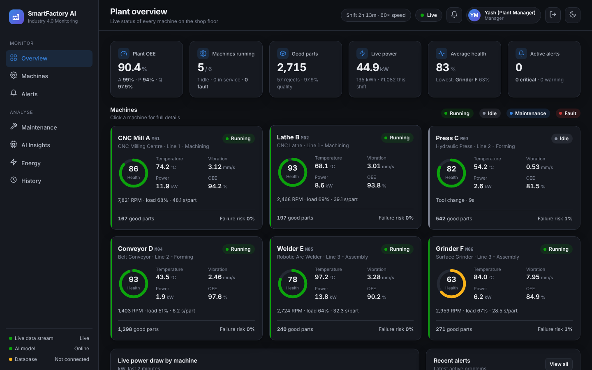
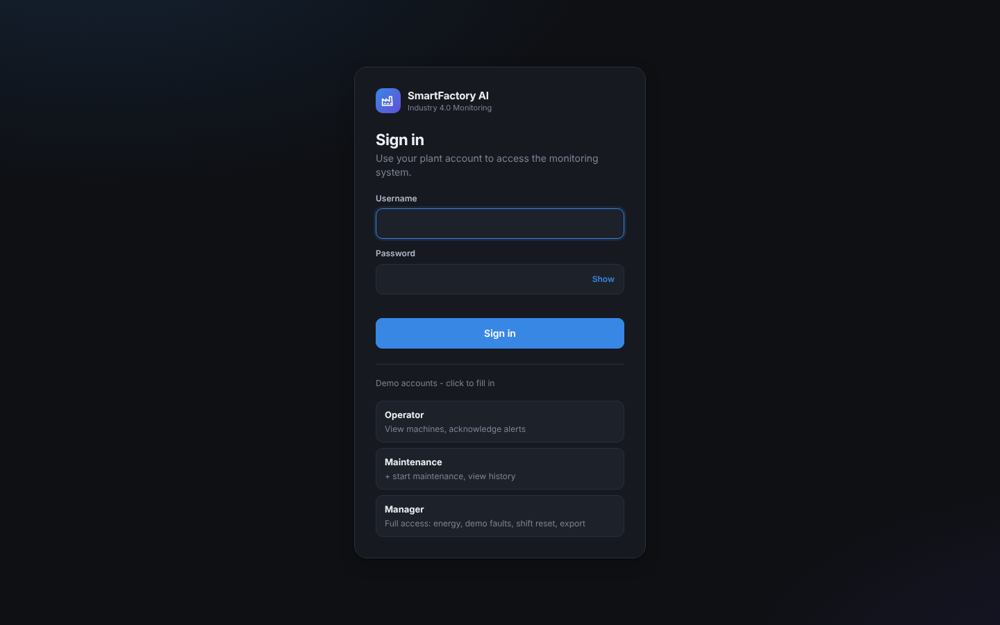
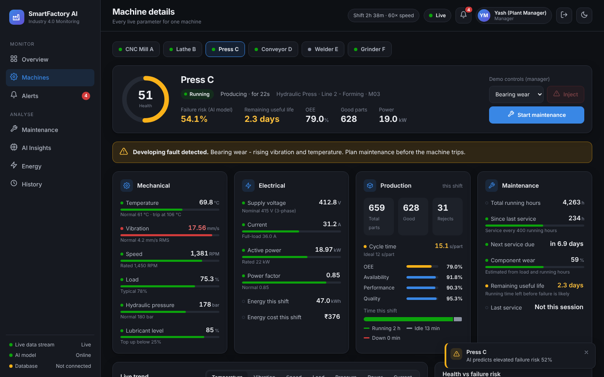
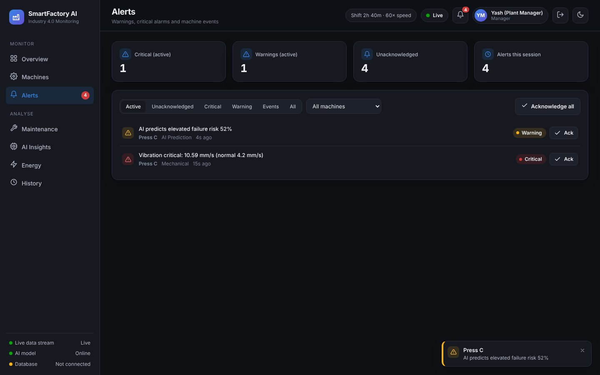
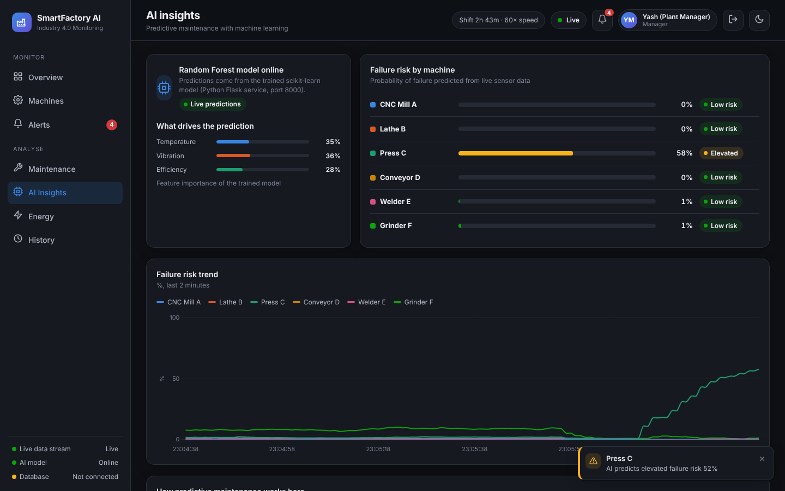
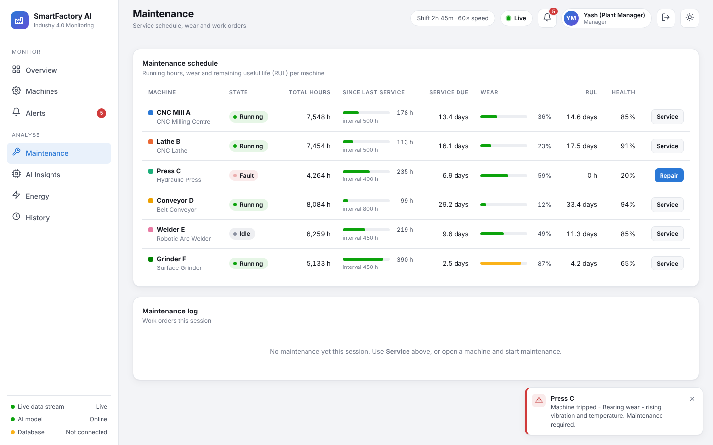
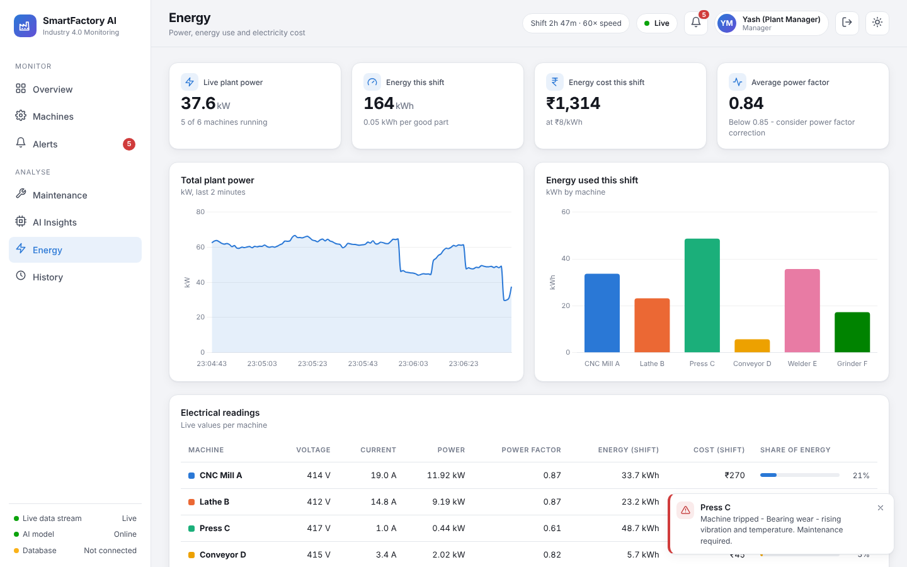

# 🏭 SmartFactory AI - Real-Time Machine Monitoring System

A web dashboard that watches factory machines **live**, warns you **before** they break down, and helps plan maintenance - using the ideas behind **Industry 4.0**, **IIoT** (Industrial Internet of Things) and **AI**.



---

## 📌 What is this project?

In a factory, a machine breaking down without warning is expensive: production stops, parts are wasted, and repairs take longer.

This project shows how a modern factory can avoid that:

1. **Sensors** on each machine send readings (temperature, vibration, speed, power...) every second.
2. A **server** collects the readings, checks them against safe limits, and raises **alerts**.
3. An **AI model** looks at the readings and predicts how likely each machine is to **fail soon**.
4. A **dashboard** shows everything live, so operators, maintenance staff and managers can act early.

> **Note:** There are no real machines connected. The six machines are **simulated** by the server so the system can be shown on any laptop. They behave realistically: they wear out over time, sometimes go idle, develop faults that slowly get worse, and stop (trip) when a limit is crossed. The rest of the system (alerts, AI, dashboard, login, database) works exactly as it would with real sensors.

---

## ✨ What it can do

| Feature | In simple words |
|---|---|
| ⏱️ **Live monitoring** | Every machine's readings update every second |
| 🌡️ **Mechanical data** | Temperature, vibration, speed (RPM), load, pressure, lubricant level |
| ⚡ **Electrical data** | Voltage, current, power, power factor, energy used, electricity cost (₹) |
| 📦 **Production data** | Parts made, rejected parts, time per part, and **OEE** (how well a machine is really being used) |
| 🔧 **Maintenance** | Running hours, when the next service is due, how worn the parts are, and how long the machine can safely keep running |
| 🚨 **Alerts** | Warnings and critical alarms when something goes wrong, with pop-up notifications |
| 🤖 **AI prediction** | A machine-learning model estimates each machine's chance of failure |
| 🔐 **Login with roles** | Operator, Maintenance and Manager accounts, each allowed to do different things |
| 📝 **Who did what** | Records who acknowledged an alert or started a repair |
| 🌗 **Dark / light theme** | Switch with one click; works on phones too |
| 💾 **History** | Saves readings to a database and exports them to Excel (CSV) |

---

## 🖼️ Screenshots

| Sign in | A machine with a developing fault |
|---|---|
|  |  |

| Alerts | AI predictions |
|---|---|
|  |  |

| Maintenance schedule (light theme) | Energy and cost (light theme) |
|---|---|
|  |  |

---

## 🧠 How it works

```
 ┌──────────────────────┐
 │  6 machines          │  Simulated sensors - one reading per second
 │  (simulator)         │
 └──────────┬───────────┘
            ▼
 ┌──────────────────────┐        ┌──────────────────────┐
 │  Backend server      │ ─────► │  AI model (Python)   │
 │  Node.js + Express   │ ◄───── │  predicts failures   │
 │  - checks limits     │        └──────────────────────┘
 │  - raises alerts     │
 │  - calculates OEE    │        ┌──────────────────────┐
 │  - checks logins     │ ─────► │  MongoDB database    │
 └──────────┬───────────┘        │  (saves history)     │
            │ live updates       └──────────────────────┘
            ▼ (WebSocket)
 ┌──────────────────────┐
 │  Dashboard           │  What people see in the browser
 │  HTML / CSS / JS     │
 └──────────────────────┘
```

**A few words explained:**
- **WebSocket** - a connection that stays open, so the server can push new readings to the browser instantly (no need to refresh the page).
- **OEE (Overall Equipment Effectiveness)** - one number showing how productive a machine really is. It multiplies three things: was it running (*Availability*), was it running at full speed (*Performance*), and were the parts good (*Quality*). World-class factories reach about 85%.
- **Remaining useful life (RUL)** - an estimate of how many running hours are left before the machine is likely to fail.
- **Random Forest** - the type of AI model used. It combines many simple "decision trees" that each vote on whether a machine is about to fail.

---

## 🚀 How to run it on your computer

### What you need first
- **[Node.js](https://nodejs.org)** (version 18 or newer) - runs the server
- **[Python](https://www.python.org)** (version 3.9 or newer) - only needed for the AI model *(optional)*
- **A MongoDB database** - *optional*. Without it everything still works, but history is lost when the server stops. A free cloud database is available at [MongoDB Atlas](https://www.mongodb.com/atlas).

### Step 1 - Download the project
```
git clone https://github.com/Techyyashh/AI-Smart-Manufacturing-System.git
cd AI-Smart-Manufacturing-System
```

### Step 2 - Start the server and dashboard
```
cd backend
npm install
npm start
```
Now open **http://localhost:5000** in your browser. 🎉

### Step 3 (optional) - Start the AI model
Open a **second terminal** and keep the first one running:
```
cd backend/ml-model
python -m pip install -r requirements.txt
python train_model.py
python app.py
```
After a few seconds the dashboard shows **"AI model: Online"**.

### Step 4 (optional) - Connect a database
1. Copy the file `backend/.env.example` and name the copy `backend/.env`
2. Open `backend/.env` and put your MongoDB connection link after `MONGO_URI=`
3. Restart the server (press `Ctrl + C`, then `npm start` again)

> ⚠️ The `.env` file holds your passwords. It is listed in `.gitignore` so it is **never uploaded to GitHub**.

---

## 🔐 Logging in

The sign-in page has buttons that fill in these demo accounts for you:

| Role | Username | Password | What they are allowed to do |
|---|---|---|---|
| 👷 **Operator** | `operator` | `Operator@123` | Watch machines and alerts, acknowledge alerts |
| 🔧 **Maintenance** | `maintenance` | `Maint@1234` | Everything above **+** start repairs, view history |
| 📊 **Manager** | `manager` | `Manager@123` | Everything **+** energy & cost page, demo faults, reset shift, export data |

**Is it secure?**
- Passwords are never stored as plain text - only as scrambled "hashes" (using *scrypt*).
- After signing in, the browser gets a **token** (a *JWT*) that lasts one 12-hour shift.
- The **server** checks what each role is allowed to do. Even if someone bypasses the screen, the server says no.
- After 5 wrong passwords, that account is locked for 5 minutes.

**Add your own account or change a password:**
```
cd backend
node scripts/createUser.js yourname YourPassword123 manager "Your Name"
```
*(Role can be `operator`, `maintenance` or `manager`.)*

---

## 🎬 Try a quick demo

1. Sign in as **Manager**.
2. Click any machine, choose a fault (for example *Bearing wear*), and press **Inject**.
3. Watch what happens over about 30 seconds:
   - vibration and temperature rise,
   - a yellow **"Developing fault detected"** banner appears,
   - alerts pop up and the **AI failure risk** climbs,
   - finally the machine **trips** (stops) to protect itself.
4. Press **Repair**. After about 25 seconds the machine is fixed and back in production, and the job appears in the **Maintenance log** with your name.
5. Sign out and sign in as **Operator** to see how fewer options are available.

---

## 📁 What's inside the folders

```
AI-Smart-Manufacturing-System/
│
├── frontend/                  👉 The dashboard (what you see in the browser)
│   ├── index.html             page layout
│   ├── style.css              colours, dark/light theme
│   └── script.js              live updates, charts, login
│
├── backend/                   👉 The server
│   ├── server.js              starts everything
│   ├── realtime.js            sends live data to the dashboard
│   ├── simulator/             the 6 machines, alert rules, link to the AI
│   ├── auth/                  login, passwords, roles
│   ├── routes/ controllers/   the API (how the dashboard talks to the server)
│   ├── models/                how data is saved in MongoDB
│   ├── config/                database connection
│   ├── scripts/               tool to create user accounts
│   └── ml-model/              👉 The AI model (Python)
│       ├── dataset.csv        example data the model learns from
│       ├── train_model.py     trains the model
│       └── app.py             serves predictions
│
└── docs/screenshots/          pictures used in this README
```

---

## 🛠️ Built with

| Part | Technology |
|---|---|
| Dashboard | HTML, CSS, JavaScript, Chart.js |
| Server | Node.js, Express, WebSocket (`ws`) |
| Database | MongoDB with Mongoose |
| AI model | Python, Flask, scikit-learn (Random Forest), pandas |
| Security | JWT tokens, scrypt password hashing, role-based access |
| Ideas | Industry 4.0, IIoT, OEE, predictive maintenance |

---

## ⚙️ Settings (optional)

These go in `backend/.env`:

| Setting | Default | What it does |
|---|---|---|
| `MONGO_URI` | *(empty)* | Link to your MongoDB database |
| `JWT_SECRET` | *(random)* | Secret key for logins. Set any long text so users stay signed in after a restart |
| `SIM_SPEED` | `60` | Hours, energy and part counts run 60× faster so a full shift fits in a short demo. Set to `1` for real time |
| `ENERGY_TARIFF` | `8` | Electricity price in ₹ per kWh |
| `PORT` | `5000` | Website address port |

---

## 🔭 Ideas for the future

- Connect **real sensors** (ESP32 with vibration, temperature and current sensors) using **MQTT**
- Train the AI on a larger real dataset (e.g. *AI4I 2020 Predictive Maintenance* from UCI)
- Support industrial protocols like **OPC UA** and **Modbus** to read data from PLCs
- Send alerts by **email or SMS**

---

## ❓ Common problems

| Problem | Fix |
|---|---|
| `Port 5000 is already in use` | The server is already running in another terminal. Stop it with `Ctrl + C` there. |
| Sidebar says **AI model: Offline** | Start the AI model (Step 3). The dashboard still works using a simple built-in estimate. |
| Sidebar says **Database: Not connected** | Check `MONGO_URI` in `backend/.env`. In MongoDB Atlas, allow your IP address under *Network Access*. |
| `can't open file app.py` | Run it from inside the `backend/ml-model` folder. |

---

## 👤 Author

**Yash** - Final-year engineering project on smart manufacturing and predictive maintenance.

If you find this project useful, please give it a ⭐ on GitHub!
